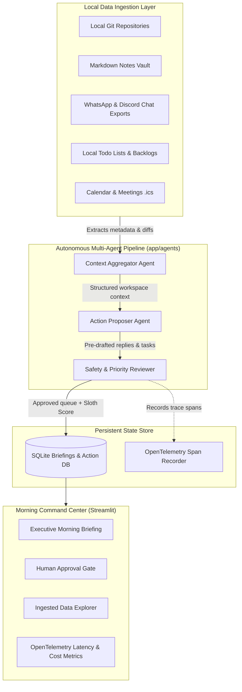
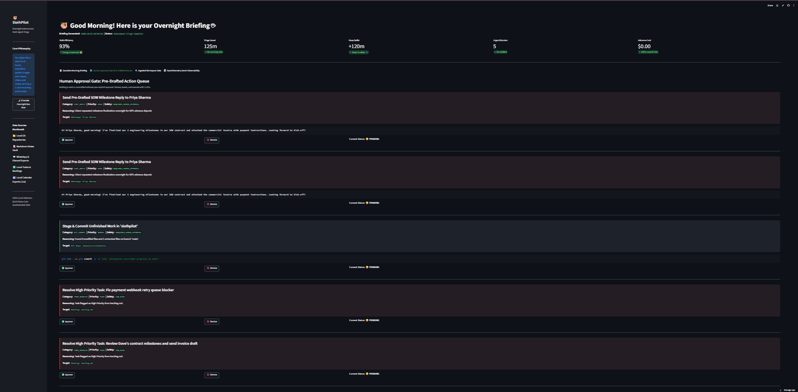
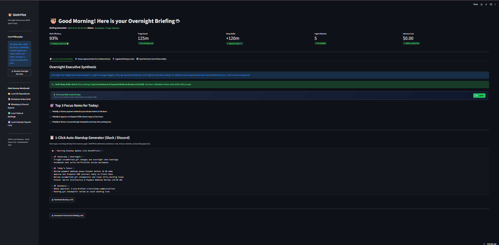

# 🦥 SlothPilot: The Autonomous Overnight Briefing & Multi-Agent Command Center

[](https://github.com/VimalN2005/slothpilot/actions)
[](https://slothpilot-xaqtgwwbpv2tfvscjhxakr.streamlit.app/)
[](https://opensource.org/licenses/MIT)
[](https://www.python.org/downloads/)
[](https://ai.google.dev/gemma)
[](https://dev.to/challenges/hacktoberfest-week3-2026-10-19)
[](https://dev.to/vimal_sahani_0ccb769da242/slothpilot-the-autonomous-overnight-multi-agent-command-center-because-developers-deserve-8-hours-5b6o)

<p align="center">
  
</p>

> **"Channel your inner sloth. You sleep 8 hours, SlothPilot works overnight."**

Built specifically for the **[Hacktoberfest 2026 Week 3 DEV Challenge](https://dev.to/challenges/hacktoberfest-week3-2026-10-19)** (Theme: *"Slow and Steady: Build something with open-source AI that rewards laziness"* — International Sloth Day, Oct 20).

---

## 🎯 The Problem: Morning Cognitive Overload

Developers spend their first 60 to 90 minutes every morning performing stressful digital archaeology:
- Checking which Git repositories were left uncommitted or on dirty branches before sleep.
- Scrolling through hundreds of messages in WhatsApp, Discord, or Slack chat exports to catch overnight emergencies or client demands.
- Sifting through scattered Markdown notes, task backlogs, and abandoned todo lists.

**SlothPilot solves this by rewarding developer laziness.** Before you go to bed, you launch a single command (or let your scheduler trigger it). While you sleep like a sloth, SlothPilot autonomously ingests your local workspace, synthesizes the overnight changes through an open-weight multi-agent pipeline, and builds a streamlined **Morning Command Center** with pre-drafted replies and a strict **1-click Human Approval Gate**.

When you wake up, you don't scramble through tabs. You grab coffee, open your dashboard, review your top 3 daily priorities, click "Approve" on pre-drafted client communications, and save 2+ hours every morning.

---

## 🏗️ Architecture & Multi-Agent Workflow



### The Three Autonomous Agents:
1. **Context Aggregator Agent (`app/agents/aggregator.py`):**
   - Synthesizes raw git status, modified files, uncommitted changes, urgent keywords from chats (`URGENT`, `BUG`, `PAYMENT`, `CONTRACT`), and high-priority backlog tasks.
2. **Action Proposer Agent (`app/agents/action_proposer.py`):**
   - Autonomously drafts contextual responses to urgent messages (e.g. client contract milestones, bug fix confirmations), generates git stash/commit commands, and schedules todo resolutions.
3. **Safety & Approval Reviewer (`app/agents/reviewer.py`):**
   - Assigns safety ratings (`SAFE`, `REQUIRES_REVIEW`, `DANGEROUS`), enforces the **Human Approval Gate** (no external actions are dispatched automatically), sets the top 3 daily focus items, and calculates the **Sloth Efficiency Score**.

### 👑 Signature Laziness Features:
- 🛌 **Sloth Sleep Buffer:** Ingests local `.ics` calendar files and calculates how many extra minutes you can sleep before your first morning meeting.
- 📋 **1-Click Auto-Standup Generator:** Pre-drafts your daily Slack/Discord standup from yesterday's commits, today's schedule, and pending approvals.
- 🎙️ **45-Second Voice Morning Briefing:** Listen to your morning digest spoken aloud in the browser without even looking at your screen.

---

## 🛡️ The Human Approval Gate: Zero Autonomous Disasters

<p align="center">
  
</p>

SlothPilot strictly adheres to the principle of safe human-in-the-loop AI:
- **No unapproved side-effects:** SlothPilot *never* automatically sends an email, commits to git, or messages a client without human intervention.
- Every pre-drafted action is staged in the **Human Approval Gate** with full transparency (reasoning, safety level, proposed payload).
- You can review, approve, tweak, or dismiss any action in 1 click.

---

## 📊 OpenTelemetry GenAI Observability

SlothPilot includes zero-dependency OpenTelemetry tracing (`app/core/telemetry.py`) to measure:
- Pipeline phase execution latencies (`slothpilot.overnight_pipeline`, `slothpilot.ingestion`, `slothpilot.propose_actions`, `slothpilot.reviewer`).
- Real-time token cost comparison ($0.00 USD for local open-weight models vs proprietary API taxes saved).
- Full W3C-compliant trace and span IDs visible directly inside the dashboard.

---

## ⚡ Quickstart & Usage

### 🌐 Instant Live Cloud Demo
Try the interactive Morning Command Center directly in your browser without any setup:
👉 **[Launch SlothPilot Live Demo](https://slothpilot-xaqtgwwbpv2tfvscjhxakr.streamlit.app/)**

<p align="center">
  
</p>

---

### 1. Clone & Set Up Locally
```bash
git clone https://github.com/VimalN2005/slothpilot.git
cd slothpilot

python -m venv venv
# Windows:
.\venv\Scripts\activate
# Linux/macOS:
source venv/bin/activate

pip install -r requirements.txt
```

### 2. Run the Overnight Autonomous Triage
Before going to sleep, run:
```bash
python scripts/run_overnight.py
```
**Output:**
```text
============================================================
[SLOTH PILOT] STARTING AUTONOMOUS OVERNIGHT RUN...
   Go to sleep. SlothPilot is triaging your workspace.
============================================================

[1/3] Ingesting local data sources (Git, Notes, Chats, Todos, Calendar)...
      [OK] Scanned 1 Git repository
      [OK] Scanned 1 Markdown notes
      [OK] Scanned 1 Chat exports
      [OK] Scanned 6 Backlog todos
      [OK] Scanned 2 Calendar events
      [OK] First Meeting: Sprint Architecture & Payment Webhook Review (10:30 AM)
      [OK] Sloth Sleep Buffer: +120 mins extra sleep!

[2/3] Running Multi-Agent Pipeline (Aggregator -> Proposer -> Reviewer)...
      [OK] Sloth Efficiency Score: 93%
      [OK] Estimated Minutes Saved: 125 mins
      [OK] Proposed Actions Queued: 5 actions

[3/3] Saving Morning Briefing to SQLite State Store...
      [OK] Saved briefing: briefing_20261021_162928
```

### 3. Automated Overnight Cron Scheduler Daemon (Set & Forget)
Prefer to never type a command before sleeping? Launch the lightweight scheduler daemon:
```bash
python scripts/schedule_overnight.py --hour 3 --minute 0
```
SlothPilot will automatically wake up at 03:00 AM every night, ingest your workspace, and stage your morning command center while you sleep.

### 4. Wake Up & Launch Your Morning Command Center
```bash
streamlit run app.py
```
Open your browser to `http://localhost:8501` to view your briefing, approve drafts, and export your markdown daily digest.

### 5. Run Unit Tests
```bash
pytest
```
All 13 test suites pass in `< 1.0s` with complete coverage of ingestion parsers (git, notes, chats, todos, calendar), standup generation, sleep buffer calculation, multi-agent pipeline nodes, and SQLite state persistence.

---

## 📁 Repository Structure

```
slothpilot/
├── .github/
│   └── workflows/
│       └── ci.yml               # GitHub Actions CI matrix (Python 3.10, 3.11, 3.12)
├── app/
│   ├── agents/
│   │   ├── __init__.py
│   │   ├── models.py            # Pydantic schemas (ProposedAction, MorningBriefing)
│   │   ├── aggregator.py        # Context Aggregator Agent
│   │   ├── action_proposer.py   # Action Proposer Agent (Drafts, Git commands)
│   │   ├── reviewer.py          # Safety & Approval Reviewer Agent
│   │   └── pipeline.py          # Master Multi-Agent Pipeline Runner
│   ├── core/
│   │   ├── __init__.py
│   │   ├── llm.py               # Ollama & Open-Weight model connector
│   │   └── telemetry.py         # OpenTelemetry Tracer & Span instrumentation
│   ├── ingestion/
│   │   ├── __init__.py
│   │   ├── models.py            # Ingestion data schemas
│   │   ├── git_parser.py        # Local Git status & commit diff scanner
│   │   ├── notes_parser.py      # Markdown notes vault parser
│   │   ├── chats_parser.py      # WhatsApp / Discord export parser
│   │   ├── todos_parser.py      # Task list & priority backlog parser
│   │   └── coordinator.py       # Master overnight ingestion coordinator
│   └── storage/
│       ├── __init__.py
│       └── db.py                # SQLite state store for briefings & approvals
├── sample_data/                 # Realistic local files for testing
│   ├── chats/
│   ├── notes/
│   └── todos/
├── scripts/
│   └── run_overnight.py         # 1-command overnight execution CLI
├── tests/
│   ├── test_ingestion.py        # 5 unit tests for ingestion parsers
│   └── test_agents_and_storage.py # 3 unit tests for agents, spans & SQLite
├── app.py                       # Streamlit Morning Command Center Dashboard
├── pyproject.toml               # Build system & pytest configuration
├── requirements.txt             # Minimal dependencies
└── README.md
```

---

## 🦥 Why Open-Source AI Matters for SlothPilot

SlothPilot operates on sensitive local artifacts: uncommitted source code, private WhatsApp/Discord chat exports, and personal notes. 

Sending this unencrypted to closed proprietary cloud APIs is a privacy nightmare and incurs unpredictable token taxes. By running open-weight models (via Ollama / Gemma / Llama) entirely locally on your machine:
1. **100% Privacy & Zero Data Exfiltration:** Your code and chats never leave your local disk.
2. **$0.00 API Cost:** Unlimited overnight analysis runs completely free.
3. **Resilience & Offline Autonomy:** SlothPilot runs smoothly even when your internet connection is down.

---

## 📜 License & Credits

- Built with ❤️ by **[Vimal Sahani](https://github.com/VimalN2005)** for Hacktoberfest 2026 Week 3 DEV Challenge.
- License: [MIT](LICENSE)
